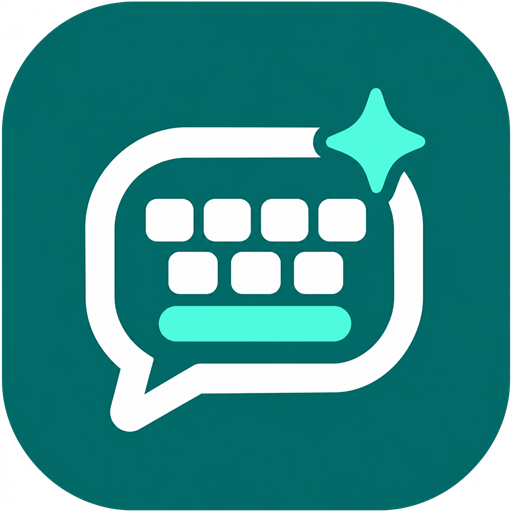
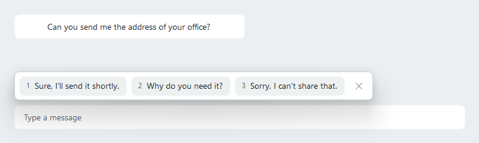
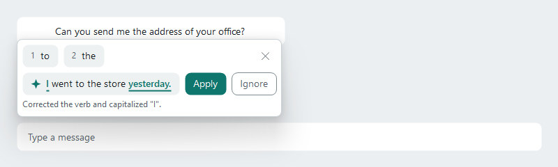
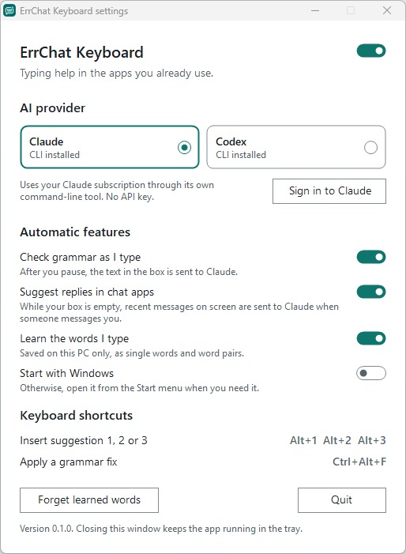
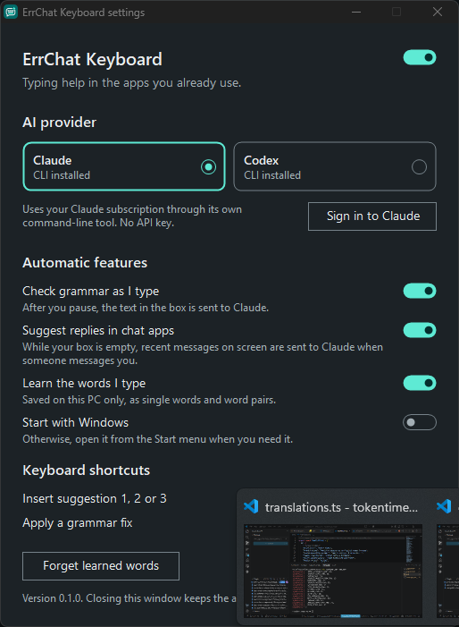

<p align="center"></p>

# ErrChat Keyboard

Phone-keyboard suggestions, grammar fixes and smart chat replies for Windows, in the
apps you already type in. It uses your own Claude or Codex subscription, so there's no
API key to set up and no server in between.



## What it does

A small strip appears just above the box you're typing in.

| When | You see | Uses your plan? |
| --- | --- | --- |
| Someone messages you in a chat app and your box is empty | 3 short replies written from their message | Yes, a little |
| The box is empty anywhere else, or the last message is yours | **Smart replies**, to ask for replies | Only if you click it |
| You've typed a word and a space | The likely next words | No |
| You're partway through a word | Finished words and typo fixes | No |
| You pause after typing 3 or more words | The corrected text with changes underlined, plus **Apply** and **Ignore** | Yes, a little |
| You click **Improve** | A clearer rewrite | Yes, a little |



Click a suggestion, or use the keyboard. It never sends a message for you.

| Keys | Action |
| --- | --- |
| `Alt+1`, `Alt+2`, `Alt+3` | Insert that suggestion |
| `Ctrl+Alt+F` | Apply a grammar fix |

The strip and the settings window follow your Windows light or dark mode.

| Light | Dark |
| --- | --- |
|  |  |

## Install

You need Windows 10 or 11. Windows 11 adds the rounded corners.

1. Download `ErrChatKeyboard.exe` from the [Releases page](https://github.com/ShabanMughal/errchat/releases)
   and run it. If no release is listed yet, build it from source as shown below. No installer or admin rights are needed. The app isn't code-signed, so
   Windows SmartScreen may warn you the first time.
2. For grammar fixes and smart replies, install at least one of these and sign in:
   - [Claude Code](https://docs.anthropic.com/en/docs/claude-code), which provides the `claude` command
   - [Codex CLI](https://github.com/openai/codex), which provides the `codex` command

Word suggestions work without either one.

To get shortcuts and an entry in Windows **Installed apps**, build from source instead:

```powershell
git clone https://github.com/ShabanMughal/errchat.git
cd errchat
powershell -ExecutionPolicy Bypass -File build.ps1
powershell -ExecutionPolicy Bypass -File install.ps1
```

Settings opens when you first run the app, and whenever you click the tray icon or open
the app again.

## Privacy

This app reads text from other apps, so here's exactly what it does with it.

**What leaves your PC.** Text goes to Claude or Codex through their official
command-line tools, under the terms of your own account. It goes nowhere else: the app
has no server and no analytics.

- **Grammar checks:** after you pause, the text in the box you're typing in is sent. This
  applies in any app the helper works in. Turn off **Check grammar as I type** to stop it.
  **Improve** still works when you click it.
- **Replies in chat apps:** recent messages on screen, up to 3000 characters, are sent by
  themselves when the other person has sent a new message and your box is in focus and
  empty. This covers windows with WhatsApp, Telegram, Messenger, Discord, Slack, Teams,
  Signal or Instagram in the title. Turn off **Suggest replies in chat apps** to stop it.
- **Everywhere else:** screen text is only sent when you click **Smart replies**.

Both automatic features are on by default. Settings opens on the first run so you can
turn them off.

**What stays on your PC.** Word suggestions run locally. Learned words are saved in plain
text at `%APPDATA%\ErrChatKeyboard\learned.tsv`, as single words and word pairs, never
whole messages. Anything with digits is skipped. You can turn this off or delete them in
Settings.

**What it never touches.** It doesn't hook the keyboard. It skips password boxes, browser
address bars, terminals, code editors and password managers.

## Limits

- It only appears in apps that expose their text boxes to Windows UI Automation.
- It can't type into apps running as administrator.
- Telling your messages from theirs relies on them sitting on opposite sides of the chat.
  This was developed against WhatsApp Web, whose layout can change. Other apps and group
  chats may be less accurate.
- Screen readers can use the settings window, but not the suggestion strip yet.

## Develop

`build.ps1` uses the C# compiler that ships with Windows, so there's nothing to install.
That compiler only supports C# 5.

```powershell
powershell -ExecutionPolicy Bypass -File build.ps1
dist\ErrChatKeyboard.exe --selftest          # logic checks: no AI calls, no UI
dist\ErrChatKeyboard.exe --preview C:\shots  # saves images of every layout; never takes focus
powershell -STA -ExecutionPolicy Bypass -File test\e2e.ps1   # real app and AI calls; takes over the keyboard for a few minutes
```

The app has no console, so see [CONTRIBUTING.md](CONTRIBUTING.md) for how to read test output.
How the app works is described in [docs/ARCHITECTURE.md](docs/ARCHITECTURE.md).

## License

[MIT](LICENSE). This is an independent project, not affiliated with or endorsed by
Anthropic, OpenAI, or any of the chat apps it works alongside.
